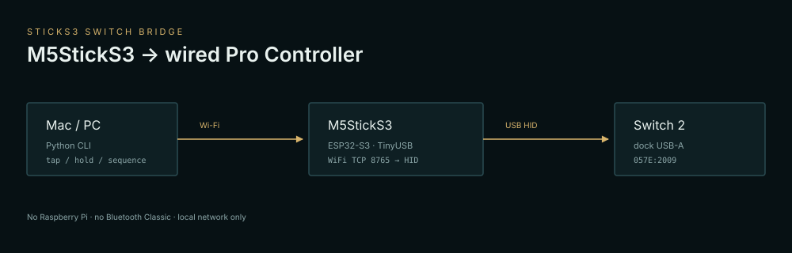

# StickS3 Switch Bridge

把 **M5StickS3**（ESP32-S3）变成 **Switch / Switch 2 认识的有线 Pro 手柄**，用 Wi‑Fi 从 Mac / PC 发按键指令。

> Turn an M5StickS3 into a wired Switch Pro Controller, controlled over Wi‑Fi.
> No Raspberry Pi, no Bluetooth Classic, no dongle.

```
Mac / PC ──WiFi TCP 8765──> M5StickS3 ──USB HID──> Switch 2 dock
```



## 为什么是 StickS3

Switch 的 Pro 手柄走 **USB HID 有线**或 **蓝牙 Classic**。ESP32-S3 没有蓝牙 Classic，
但有 **原生 USB OTG**，可以枚举成有线 Pro 手柄；M5StickS3 自带 USB‑C、屏幕、按键和
8MB Flash + 8MB PSRAM，正好塞下 HID 固件和 Wi‑Fi。

- 已实测：**M5StickS3 (ESP32‑S3‑PICO‑1 N8R8) + Switch 2 底座**。
- Switch 2 设置里打开 **Pro 手柄有线通讯**。
- 同一份代码也可编到 Cardputer‑ADV（8MB，无 PSRAM）和 CoreS3（16MB + 8MB）。

## 功能

- 完整按键：A/B/X/Y、L/R/ZL/ZR、十字键、Plus/Minus、Home/Capture、L3/R3。
- 左右摇杆 12‑bit（0–4095，中心 2048）。
- Wi‑Fi TCP 8765，49 字节包；2 秒无包自动松键。
- 附带 Python 主机端：`tap`、`hold`、`combo`、`stick`、`sequence`、`shell`、`test`。
- 没有 LittleFS / 图执行器 / BLE sniffer / OTA，固件 1MB 以内。

## 硬件

| 件 | 说明 |
|---|---|
| M5StickS3 | ESP32‑S3‑PICO‑1，8MB Flash + 8MB PSRAM |
| USB‑C 数据线 | 必须能传数据，不是纯充电线 |
| Switch 2 底座 | USB‑A 口 |
| 2.4GHz Wi‑Fi | ESP32‑S3 不支持 5GHz |

接线：**StickS3 USB‑C → Switch 底座 USB‑A**。供电来自底座；Wi‑Fi 只负责收指令。

## 构建

需要 PlatformIO Core（或 VS Code + PlatformIO）。本项目用 pioarduino 的 ESP32 平台：

```bash
cd firmware
cp src/wifi_secrets.h.example src/wifi_secrets.h
# 编辑 src/wifi_secrets.h，填 2.4GHz SSID / 密码

pio run -e sticks3 -t upload
pio device monitor -e sticks3
```

`wifi_secrets.h` 已在 `.gitignore` 里，**不要提交真实密码**。

首次构建会下载 pioarduino 平台和 Adafruit TinyUSB，约 20–30 分钟；之后增量构建很快。

已验证（2026-10-26）：

```
pio run -e sticks3  SUCCESS
Flash 29.8% (996 KB / 3.3 MB app)
RAM   21.2%
```

> 本固件只有 Wi‑Fi TCP；`host/esp32_switch.py --port` 的串口路径保留给 UART 固件/其他板子，
> 不是这个 StickS3 构建的默认用法。TCP 模式不需要 pyserial。

### 烧录进下载模式

StickS3 如果不进下载模式：按住侧面 reset 键，直到绿灯闪烁，再执行 upload。
上传完成后短按一次开关机键/复位键启动应用。

## 使用

1. 串口日志会打印：

   ```
   WiFi OK, IP=192.168.x.x, TCP=8765
   ```

2. 拔掉 Mac，把 StickS3 插到 Switch 2 底座 USB‑A。
3. Switch 2：设置 → 手柄与外设 → **Pro 手柄有线通讯** → 开。
4. 在 Mac / PC 上：

```bash
cd host
python3 -m pip install pyserial   # 只有串口模式需要
python3 esp32_switch.py --tcp 192.168.x.x:8765 tap A
python3 esp32_switch.py --tcp 192.168.x.x:8765 test
```

常用：

```bash
python3 esp32_switch.py --tcp <IP>:8765 tap A,B
python3 esp32_switch.py --tcp <IP>:8765 hold ZR 1.5
python3 esp32_switch.py --tcp <IP>:8765 stick left 1024 2048
python3 esp32_switch.py --tcp <IP>:8765 sequence "A:0.1,wait:0.3,DOWN:0.1"
python3 esp32_switch.py --tcp <IP>:8765 shell
```

完整按键和命令见 [`host/CONTROLS.md`](host/CONTROLS.md)。

## 协议

```
AA 55 | cmd(0x00) | 45-byte report | XOR
```

45 字节报告 = 3 字节按键 + 3 字节左摇杆 + 3 字节右摇杆 + 36 字节 IMU。
详见 [`docs/PROTOCOL.md`](docs/PROTOCOL.md)。

## M5Stack 玩法

- **桌面小手柄**：StickS3 插底座，Wi‑Fi 发宏，适合菜单/刷素材/重复操作。
- **无障碍/辅助输入**：用脚本或语音前端代替部分手柄操作。
- **AI 教练/读屏**：Mac 侧 OCR 读游戏画面，再把决策通过 Wi‑Fi 发回手柄。
- **直播/自动化**：OBS、Stream Deck、快捷指令都能通过 TCP 调用。
- **掌机外壳**：3D 打印一个底座，把 StickS3 做成桌面控制器。

## 兼容性 / 验证

| 硬件 | 状态 |
|---|---|
| M5StickS3 + Switch 2 | ✅ 实测 |
| Switch 1 | ⏳ 未实测 |
| Cardputer-ADV | ⏳ 能编译，未实测 |
| CoreS3 | ⏳ 能编译，未实测 |

遇到问题先看 [`docs/TROUBLESHOOTING.md`](docs/TROUBLESHOOTING.md)。

## 限制

- **没有震动**：当前 45 字节输入报告不带 rumble。
- **IMU 是固定重力**：可以改包，但不是真实体感。
- **Wi‑Fi 2.4GHz only**；TCP **没有鉴权**，只适合可信局域网。
- Switch 固件更新可能改变 HID 握手；本项目只在实测版本上验证过。
- 不是任天堂/M5Stack 官方产品；自担风险。

## 目录

```
firmware/          ESP32-S3 固件（PlatformIO）
  src/             main + SwitchPro HID driver/descriptors
host/              Mac/PC Python 客户端
  esp32_switch.py  CLI（TCP / 串口）
  gamepad.py       包构造 / Controller API
  tests/           纯协议单元测试
docs/              协议与架构图
```

## Credits

- HID 描述符、驱动与握手逻辑来自 [churunfa/SwitchProControllerEsp32S3](https://github.com/churunfa/SwitchProControllerEsp32S3)（MIT，Copyright © 2026 crf）。
- Adafruit TinyUSB 库。
- 本项目其余代码 MIT。

## 交接 / 开发

- [`HANDOFF.md`](HANDOFF.md) — 当前状态、已知坑、下一步
- [`CONTRIBUTING.md`](CONTRIBUTING.md)
- [`SECURITY.md`](SECURITY.md)
- [`docs/TROUBLESHOOTING.md`](docs/TROUBLESHOOTING.md)

## License

MIT。见 [`LICENSE`](LICENSE) 与 [`THIRD_PARTY_NOTICES.md`](THIRD_PARTY_NOTICES.md)。
